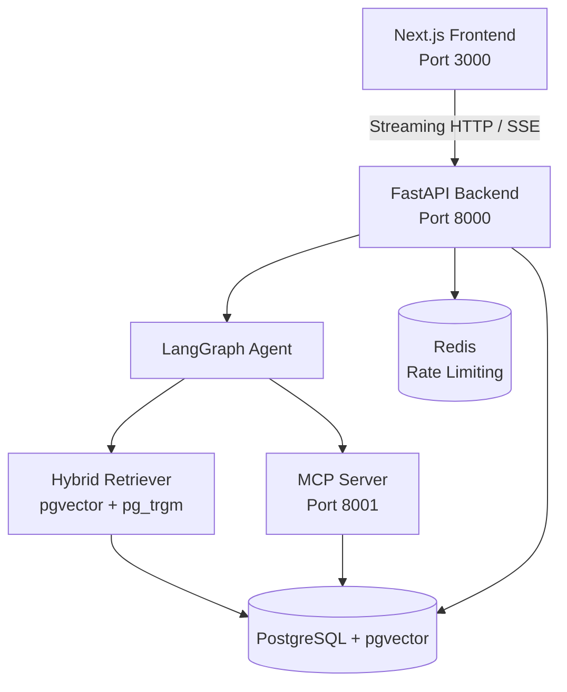
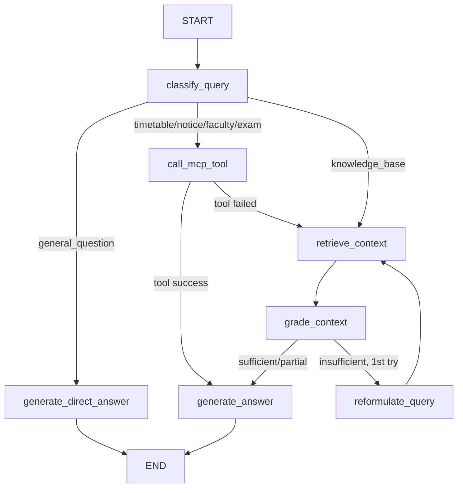
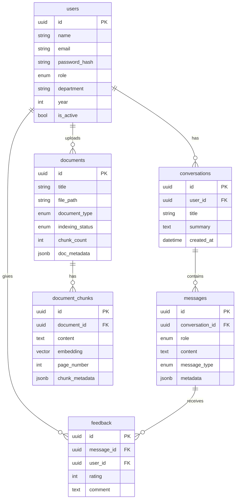

# WalchandGPT — AI-Powered College Assistant

> A production-grade, agentic AI assistant for **Walchand College of Engineering, Sangli**.  
> Built with LangChain, LangGraph, MCP, pgvector RAG, FastAPI, and Next.js.

[](https://python.org)
[](https://fastapi.tiangolo.com)
[](https://nextjs.org)
[](https://postgresql.org)
[](https://github.com/langchain-ai/langgraph)

---

## 📸 Features

- 🤖 **Agentic LangGraph Workflow** — multi-node graph with conditional routing
- 📄 **Hybrid RAG** — pgvector ANN + pg_trgm keyword search + Reciprocal Rank Fusion
- 🔧 **MCP Server** — Model Context Protocol tools for structured college data
- ⚡ **SSE Streaming** — token-by-token response with real-time status events
- 🔐 **JWT Auth + RBAC** — student / faculty / admin roles
- 📊 **Admin Dashboard** — document management, analytics, tool logs
- 📝 **Citations** — every RAG answer shows source documents
- 💬 **Persistent Memory** — conversations stored in PostgreSQL
- 🐋 **Docker Compose** — one-command local setup

---

## 🏗 Architecture



---

## 🔀 LangGraph Workflow



**Nodes:**
| Node | Purpose |
|------|---------|
| `classify_query` | Classifies intent using a cheap LLM call (0-temperature) |
| `retrieve_context` | Hybrid vector+keyword search with metadata filtering |
| `grade_context` | Evaluates retrieved context sufficiency |
| `reformulate_query` | Rewrites question to improve second-attempt retrieval |
| `call_mcp_tool` | Calls structured college data tools via MCP protocol |
| `generate_answer` | RAG answer with citations using retrieved docs + tool results |
| `generate_direct_answer` | Directly answers general questions without retrieval |

---

## 🔧 MCP Architecture

```
LangGraph Agent
      │
      ▼
MCPClient (HTTP)
      │
      ▼
MCP Server (FastAPI, Port 8001)
  ├── /tools/get_timetable
  ├── /tools/get_notices
  ├── /tools/get_faculty
  ├── /tools/get_exam_schedule
  ├── /tools/get_events
  ├── /tools/get_placement_statistics
  ├── /tools/get_department_info
  └── /tools/search_college_database
```

The agent uses **conditional routing** to call MCP tools only when the intent requires structured/live data (timetables, notices, faculty info). It does NOT call tools for general questions.

The `MCPClient` implements **circuit-breaker fallback** — if the MCP server is down, it falls back to RAG gracefully.

---

## 📚 RAG Pipeline

```
Document Upload (PDF/DOCX/TXT/CSV)
         │
    Document Loader (LangChain)
         │
    Text Extraction + Cleaning
         │
    Recursive Text Splitter (1000 chars, 200 overlap)
         │
    Metadata Extraction (department, type, page)
         │
    Embedding Generation (OpenAI / Google / Ollama)
         │
    pgvector Storage + pg_trgm Index
         │
         ▼
    Query Time:
    User Question → Embed → Vector ANN Search
                         → Keyword Trigram Search
                         → Reciprocal Rank Fusion
                         → Top-K Reranked Chunks
                         → LLM (with citations)
```

---

## 🗄 Database Schema



---

## 🚀 Quick Start

### Prerequisites
- Docker & Docker Compose
- An LLM API key (OpenAI / Google Gemini / or local Ollama)

### 1. Clone and configure

```bash
git clone https://github.com/yourusername/walchandgpt
cd walchandgpt
cp .env.example .env
```

Edit `.env` with your API keys:

```env
LLM_PROVIDER=openai
MODEL_NAME=gpt-4o-mini
OPENAI_API_KEY=sk-...

EMBEDDING_PROVIDER=openai
EMBEDDING_MODEL=text-embedding-3-small
```

### 2. Start all services

```bash
docker compose up
```

### 3. Initialize database and seed demo data

```bash
# Run migrations
docker compose exec backend alembic upgrade head

# Seed demo users (admin/student/faculty accounts)
docker compose exec backend python scripts/seed_data.py
```

### 4. Open the app

| Service | URL |
|---------|-----|
| Frontend | http://localhost:3000 |
| Backend API | http://localhost:8000 |
| API Docs | http://localhost:8000/api/docs |
| MCP Server | http://localhost:8001 |

### 5. Demo credentials

| Role | Email | Password |
|------|-------|---------|
| Admin | admin@walchandsangli.ac.in | Admin@1234 |
| Student | student@walchandsangli.ac.in | Student@1234 |
| Faculty | faculty@walchandsangli.ac.in | Faculty@1234 |

---

## 🔑 Environment Variables

| Variable | Description | Default |
|----------|-------------|---------|
| `LLM_PROVIDER` | `openai` / `google` / `ollama` | `openai` |
| `MODEL_NAME` | LLM model to use | `gpt-4o-mini` |
| `OPENAI_API_KEY` | OpenAI API key | — |
| `GOOGLE_API_KEY` | Google Gemini API key | — |
| `EMBEDDING_MODEL` | Embedding model | `text-embedding-3-small` |
| `DATABASE_URL` | Async PostgreSQL URL | — |
| `JWT_SECRET` | Secret for JWT signing | — |
| `MCP_SERVER_URL` | MCP server endpoint | `http://localhost:8001` |
| `STORAGE_PROVIDER` | `local` or `s3` | `local` |
| `LANGCHAIN_TRACING_V2` | Enable LangSmith | `false` |

See `.env.example` for the full list.

---

## 🧪 Testing

```bash
# Run all unit tests
cd backend && pytest tests/unit/ -v

# Run with coverage
pytest tests/ --cov=app --cov-report=html

# Run specific test file
pytest tests/unit/test_graph_routing.py -v
```

---

## 📁 Project Structure

```
walchandgpt/
├── frontend/              # Next.js 15 + TypeScript + Tailwind
│   ├── app/
│   │   ├── chat/          # Main chat interface
│   │   ├── admin/         # Admin dashboard
│   │   └── login/         # Authentication
│   ├── hooks/useAuth.tsx  # Auth context
│   ├── lib/api.ts         # API client + SSE streaming
│   └── types/index.ts     # TypeScript types
│
├── backend/               # Python FastAPI
│   ├── app/
│   │   ├── api/routes/    # REST endpoints
│   │   ├── core/          # Config, security, deps
│   │   ├── db/            # SQLAlchemy session
│   │   ├── models/        # ORM models
│   │   ├── schemas/       # Pydantic schemas
│   │   ├── services/      # Business logic
│   │   ├── rag/           # Retriever + pipeline + loaders
│   │   ├── graph/         # LangGraph state, nodes, edges
│   │   ├── agents/        # MCP client
│   │   └── llm/           # Provider factory + prompts
│   └── tests/
│
├── mcp-server/            # MCP tool server (FastAPI)
│   └── tools/             # College-specific tools
│
├── scripts/               # DB init, seed data
├── storage/               # Document storage (local)
├── docker-compose.yml
└── .env.example
```

---

## 🔌 API Reference

```
POST /api/auth/register       Register new user
POST /api/auth/login          Login
GET  /api/auth/me             Current user

POST /api/chat/stream         Streaming chat (SSE)

GET  /api/conversations       List user conversations
POST /api/conversations       Create conversation
GET  /api/conversations/{id}  Get conversation + messages
DEL  /api/conversations/{id}  Delete conversation

GET  /api/documents           List documents
POST /api/documents           Upload document (admin)
DEL  /api/documents/{id}      Delete document (admin)
POST /api/documents/{id}/reindex  Re-index document (admin)

POST /api/feedback            Submit message feedback

GET  /api/admin/analytics     Analytics dashboard (admin)
GET  /api/admin/tool-logs     Tool execution logs (admin)
```

Full OpenAPI docs: http://localhost:8000/api/docs

---

## 🧠 Viva Q&A

**Q: Why LangGraph instead of a simple LangChain chain?**  
A: A simple chain is linear — input → retrieval → LLM → output. LangGraph supports stateful, conditional graphs where the agent can classify intent, decide whether to call a tool or retrieve documents, reformulate queries on insufficient context, and iterate. This reflects real-world agent behavior.

**Q: Why MCP?**  
A: MCP provides a standardized protocol for tool discovery and invocation. The LangGraph agent calls college-specific structured data (timetables, notices, faculty) through MCP without hardcoding tool calls into application logic. The MCP server can be updated or scaled independently.

**Q: How does streaming work?**  
A: The FastAPI endpoint returns a `StreamingResponse` with `text/event-stream` media type. The LangGraph `astream_events()` API yields events as the graph executes. The frontend uses the `EventSource`-compatible `fetch()` with `body.getReader()` to process SSE frames in real time.

**Q: How are citations generated?**  
A: After RAG retrieval, each chunk includes its source document title, page number, and cosine similarity score. The `generate_answer` node collects these into `Citation` objects filtered by `similarity_score > 0.3`. These are persisted in the message's JSONB `metadata` column.

**Q: How is hallucination prevented?**  
A: (1) The RAG system prompt instructs the model to answer ONLY from retrieved context. (2) A `grade_context` node evaluates whether context is sufficient before generating. (3) The system explicitly says "I don't have information" when context is insufficient. (4) MCP tools fetch current structured data instead of relying on model memory.

**Q: What happens if the MCP server is down?**  
A: `MCPClient.connect()` marks the server as unavailable. When `call_mcp_tool` fails, the `route_after_tool` edge falls back to `retrieve_context` (RAG). The answer is generated from documents rather than crashing.

**Q: How would you scale this?**  
A: Horizontal API scaling with load balancer; separate document ingestion workers (Celery); Redis caching for repeated queries; pgvector IVFFlat/HNSW indexes for ANN search at scale; CDN for document storage.

---

## 🔮 Future Improvements

- 🎙 Voice assistant interface (Web Speech API)
- 📱 WhatsApp bot integration
- 🇮🇳 Multilingual support (Marathi / Hindi)
- 📅 ERP integration (attendance, grades, timetable live sync)
- 📊 Personalized student dashboard (your schedule, your backlog)
- 📱 React Native mobile app
- 🔄 Automatic document sync from college website
- 🧪 Automated RAG evaluation with RAGAS

---

## 📄 License

MIT License — see [LICENSE](LICENSE)

---

> **⚠️ Note:** All demo/seed data in this project is fictional and clearly marked. Do not present seed data as official Walchand College information.
